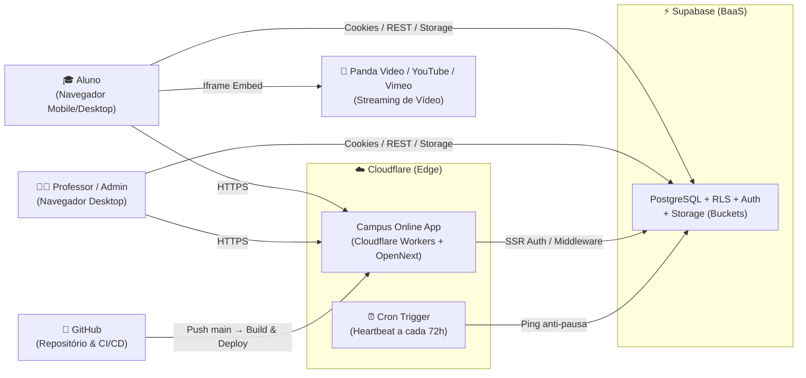
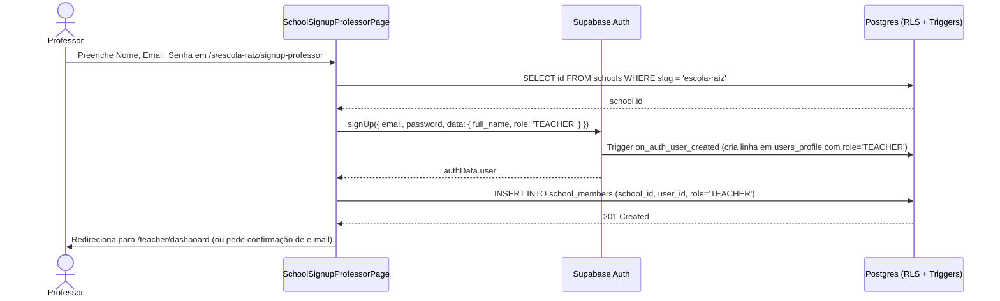
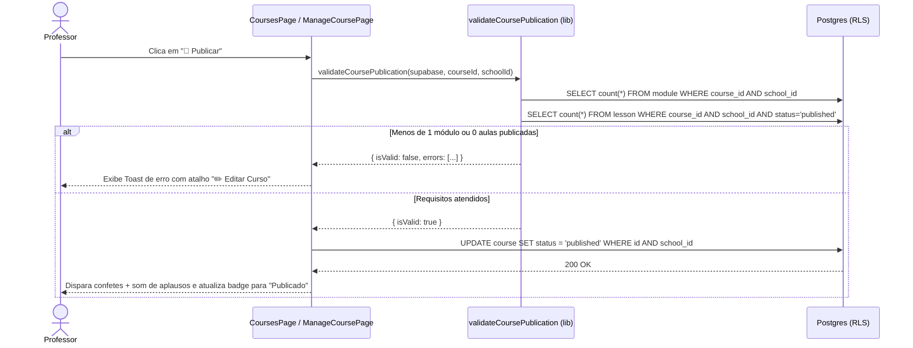

# Arquitetura — Campus Online SaaS

## 1. Resumo e premissas

### 1.1 Conclusão em linguagem simples (leia primeiro)

O **Campus Online SaaS** tem uma arquitetura enxuta e bem escolhida para o estágio atual: uma única aplicação web (**Next.js 15**) que conversa diretamente com um banco de dados e sistema de login gerenciados (**Supabase**). Não há servidor próprio intermediário para manter, o que reduz o custo fixo mensal para **R$ 0** nos planos gratuitos de entrada.

**Sobre o deploy na Cloudflare Workers via GitHub:**
**Sim, é 100% viável e recomendado (ADR-003).** O código não usa nenhuma biblioteca presa a servidores tradicionais (todos os uploads vão direto do navegador para o Supabase Storage, e o login usa cookies compatíveis com a borda). Para publicar na Cloudflare Workers a partir do GitHub, usamos o adaptador oficial **`@opennextjs/cloudflare`**. Como bônus, a Cloudflare Workers permite configurar um "despertador" gratuito (*Cron Trigger*) que faz uma leitura leve no Supabase a cada 3 dias, impedindo que o banco gratuito do Supabase seja pausado por inatividade (que ocorre após 7 dias sem uso).

**Onde dói hoje (descobertas da auditoria no código e nas migrações):**
Antes de subir para a Cloudflare Workers e recriar o banco no Supabase, encontramos **6 dívidas técnicas (`DT-01` a `DT-06`)**, sendo **3 bloqueantes (Classe A)**:
1. **`DT-01` (Quebra o build na Cloudflare):** O arquivo `lib/database.types.ts` contém duas linhas de texto de erro de terminal em vez de código TypeScript, fazendo `npx tsc --noEmit` e `npm run build` falharem.
2. **`DT-02` (Quebra o cadastro de usuários no banco novo):** O código de cadastro depende de um gatilho automático (*Trigger*) no Supabase para criar a linha em `users_profile` quando alguém cria conta, mas esse *Trigger* não foi salvo em nenhum arquivo `.sql` da pasta `supabase/`. Se rodarmos apenas os `.sql` atuais num Supabase novo, `users_profile` ficará vazio e o login de professor falhará.
3. **`DT-03` (Quebra a criação de categorias no banco novo):** A tela de categorias grava a coluna `description`, mas nenhum arquivo `.sql` em `supabase/` cria essa coluna na tabela `category`.

**O que você precisa aprovar:**
1. A adoção oficial da **Cloudflare Workers com OpenNext (`ADR-003`)** integrada ao GitHub.
2. A autorização para corrigirmos as 3 dívidas Classe A (`DT-01`, `DT-02`, `DT-03`) e gerarmos um **único script SQL consolidado** para você colar uma única vez no seu novo projeto Supabase.

---

### 1.2 Modo e porte

- **Modo:** **Auditoria de código existente** (Passo 7) combinada com decisão de hospedagem (`ADR-003`), pois o repositório já possui ~5.200+ linhas de código e 19 migrações SQL, mas não possuía PRD nem `architecture.md`.
- **Porte:** **Completo**, justificado por 3 sinais presentes no produto:
  1. Sistema **multi-organização (Multi-tenant)** com isolamento por escola (`schools` e `school_members`);
  2. Estrutura de **controle financeiro/acesso a compras** (`entitlements`, tiers de cursos e preparação para gateways de pagamento como Asaas/Hotmart/Stripe);
  3. Múltiplas **integrações externas** previstas (Supabase Auth/DB/Storage, Panda Video/YouTube/Vimeo, Cloudflare Workers e Gateways de Pagamento).

---

### 1.3 Premissas e restrições

1. **[Confirmada]** O projeto original no Supabase foi pausado/removido por inatividade do plano gratuito e será recriado do zero.
2. **[Confirmada]** O código-fonte está hospedado no GitHub (`branch main`) e o deploy contínuo (CI/CD) deve partir do GitHub para a Cloudflare Workers.
3. **[Premissa — revisar quando houver tráfego real]** Volume inicial estimado em até 5 escolas e até 500 alunos ativos simultâneos, operando dentro dos limites gratuitos (Free Tier) do Supabase e da Cloudflare Workers.
4. **[Premissa]** Os vídeos das aulas jamais são hospedados no Supabase Storage; são sempre embarcados via player externo (Panda Video, YouTube ou Vimeo).

---

### 1.4 O que o PRD decidiu e o destino de cada decisão

Como o projeto nasceu direto no código sem um documento PRD prévio, a tabela abaixo confronta as decisões implícitas da base atual (documentadas em `README.md` e `DOCUMENTACAO.md`) com o destino arquitetural:

| Decisão herdada (implícita no código/README) | Destino | Onde mora agora |
|---|---|---|
| Aplicação monolítica em Next.js 15 (App Router) + React 19 + Tailwind CSS | **Ratificada** | `ADR-001` |
| Backend-as-a-Service no Supabase (Auth, Postgres, Storage) com acesso direto pelo cliente/SSR | **Refinada** (exige Trigger versionado em SQL e anti-pausa) | `ADR-001`, `DT-02` |
| Isolamento Multi-tenant por coluna `school_id` e políticas RLS no Postgres | **Refinada** (unicidade de `slug` deve ser por escola, não global) | `ADR-002`, `DT-04` |
| Hospedagem sugerida na Vercel (`README.md` §Deploy) | **Emendada** para **Cloudflare Workers** via `@opennextjs/cloudflare` | `ADR-003` |
| Modelo comercial de cursos por `entitlements` e `course_tier` (`TIER_1` a `TIER_5`) | **Refinada** (protegido no banco, mas falta aplicar bloqueio na UI do aluno) | Seção 4.2, `DT-05` |

---

## 2. Requisitos de qualidade (RQ-NN)

| ID | Atributo | Cenário (estímulo → resposta) | Medida e limite | Como medir | Base | Tática escolhida |
|---|---|---|---|---|---|---|
| **RQ-01** | **Disponibilidade (Anti-Inatividade)** | Projeto no plano gratuito do Supabase fica 7 dias sem acesso humano | Banco **não** é pausado automaticamente pelo Supabase | Job agendado (Cron) a cada 72h fazendo `SELECT count(*) FROM schools` com status HTTP 200 | Regra do plano Free do Supabase (pausa após 7 dias inativo) | Cron Trigger na Cloudflare Workers (ou GitHub Actions) a cada 3 dias (`EV-01`) |
| **RQ-02** | **Isolamento Multi-Tenant (Segurança)** | Professor ou Aluno autenticado na Escola A tenta ler ou alterar cursos, módulos, aulas ou categorias da Escola B | **0 registros** retornados ou afetados em qualquer tabela de conteúdo | Consulta SQL / cliente Supabase com sessão de usuário não-membro da Escola B | Requisito estrutural SaaS | Row Level Security (RLS) obrigatório em todas as tabelas com checagem em `school_members` (`ARQ-01`) |
| **RQ-03** | **Desempenho na Borda (Edge)** | Aluno acessa o catálogo (`/s/[schoolSlug]/student/home`) ou tela de login a partir do Brasil | Tempo até o primeiro byte (TTFB) da casca da página em **até 800 ms (p95)** | Cloudflare Workers Analytics / DevTools Network | Premissa (revisar com primeiros 100 alunos) | Deploy em Cloudflare Workers (rede global no Brasil) + assets estáticos servidos via Workers Assets (`ADR-003`) |
| **RQ-04** | **Portabilidade de Runtime (Build Limpo)** | Push na branch `main` do GitHub dispara o build para Cloudflare Workers | Compilação TypeScript (`tsc --noEmit`) e bundle OpenNext concluem em **até 3 minutos com 0 erros** | Log do Cloudflare Workers Builds / GitHub Actions | Premissa técnica | Zero dependências nativas de Node/C++ em runtime + `nodejs_compat` ativo (`ARQ-03`) |

> **Conflito registrado (Custo Zero vs. Disponibilidade do Banco):** O plano gratuito do Supabase economiza US$ 25/mês, mas pausa o banco após 7 dias sem requisições e exclui projetos pausados após 90 dias. A escolha arquitetural (`ADR-001` + `RQ-01`) resolve o conflito mantendo o custo zero através de um *heartbeat* automático a cada 3 dias, migrando para o plano Pro apenas quando o gatilho `EV-01` disparar.

---

## 3. Visão estrutural

### 3.1 Contexto do sistema (Nível 1)


*Legenda 3.1: O navegador carrega a aplicação servida pelo Cloudflare Worker, autentica e consome dados diretamente do Supabase protegido por RLS, e reproduz vídeos direto dos provedores de streaming.*

---

### 3.2 Contêineres e componentes (Nível 2)

```mermaid
flowchart TD
    subgraph Worker["Cloudflare Worker (.open-next/worker.js)"]
        MW["middleware.ts\n( Guarda de rotas /teacher/* via @supabase/ssr )"]
        AuthCB["app/auth/callback/route.ts\n( Troca de código OAuth/Email por Sessão )"]
        Landing["app/page.tsx\n( Validador de Código da Escola )"]
        TeacherApp["app/teacher/*\n( Dashboard, Categorias, Cursos, CurriculumBuilder )"]
        StudentApp["app/s/[schoolSlug]/student/*\n( Home Streaming, Discovery Quiz, Watchlist, Player, Perfil )"]
        Shared["lib/* & components/*\n( SchoolProvider, validateCoursePublication, UI Kit )"]
    end

    subgraph Supabase["Supabase Project"]
        Auth["Supabase Auth\n(auth.users + Trigger on_auth_user_created)"]
        DB[("PostgreSQL (RLS Ativo)\nschools, school_members, users_profile,\ncategory, course, module, lesson,\nresource, entitlements, watchlist, diagnostic_*")]
        Storage["Supabase Storage\nBuckets: course-thumbnails,\nlesson-resources, avatars"]
    end

    MW --> Auth
    MW --> DB
    AuthCB --> Auth
    Auth -->|Trigger SQL| DB
    Landing --> DB
    TeacherApp --> Shared
    StudentApp --> Shared
    Shared -->|@supabase/ssr Browser Client| DB
    Shared -->|Upload direto| Storage
```
*Legenda 3.2: Divisão interna da aplicação Next.js rodando no Worker e sua comunicação com Auth, Banco Postgres e Buckets do Supabase.*

---

### 3.3 Módulos e onde mora cada tipo de lógica

| Tipo de lógica | Onde mora hoje no código | Observação arquitetural |
|---|---|---|
| **Apresentação e rotas públicas** | `app/page.tsx`, `components/BrandLogo.tsx`, `components/ui/*` | Componentes Client-side (`'use client'`) com Tailwind CSS. |
| **Autenticação e guarda de sessão** | `middleware.ts`, `app/auth/callback/route.ts`, `app/teacher/layout.tsx`, `app/s/[schoolSlug]/student/layout.tsx` | Dupla checagem: `middleware.ts` protege `/teacher/*` na borda; `StudentLayout` protege `/s/[schoolSlug]/student/*` no cliente. |
| **Contexto Multi-tenant (Escola ativa)** | `lib/school-context-provider.tsx` (Professor/Admin) e parâmetro de URL `params.schoolSlug` (Aluno) | No painel do professor, `SchoolProvider` busca a escola via `school_members`; na área do aluno, a escola vem da URL `/s/[schoolSlug]`. |
| **Regras de negócio de publicação** | `lib/course-publishing.ts` (`validateCoursePublication`) + Trigger SQL `check_course_access_update_permission` | Regra de publicação (mín. 1 módulo + 1 aula publicada) roda no cliente; proteção de campos comerciais (`access_model`, `course_tier`) roda em Trigger no Postgres. |
| **Acesso a dados e arquivos** | Chamadas diretas via `createClient()` (`lib/supabase-client.ts`) dentro das páginas de `app/` | Padrão BaaS: não há camada de API intermediária; a segurança depende integralmente das políticas RLS no banco (`ARQ-01`). |

---

### 3.4 Dono de cada dado (fonte da verdade)

| Dado | Fonte da verdade (Dono) | Cópias / Derivados | Regra de sincronismo |
|---|---|---|---|
| **Credenciais e Sessão (`email`, `senha`, `uid`)** | `auth.users` (Supabase Auth) | Cookies HTTP gerenciados por `@supabase/ssr` | Automático via SDK do Supabase. |
| **Perfil público (`name`, `role`, `avatar_url`, `bio`)** | `public.users_profile` | Estado React nos Layouts (`TeacherLayout`, `StudentLayout`) | Criado no signup por Trigger SQL (`DT-02`) e atualizado via `upsert` na tela de perfil. |
| **Vínculo Usuário ↔ Escola e Papel na Escola** | `public.school_members` (`school_id`, `user_id`, `role`) | Contexto React `SchoolProvider` | Inserido no cadastro do professor ou via convite/matrícula. É a tabela que governa todas as políticas RLS. |
| **Catálogo e Conteúdo (`category`, `course`, `module`, `lesson`, `resource`)** | Tabelas respectivas no Postgres (`public.*`) | View `course_stats` (contagem de módulos e aulas publicadas) | Escrita restrita a `TEACHER` e `ADMIN` da respectiva `school_id`. |
| **Direitos de Acesso / Compras (`entitlements`)** | `public.entitlements` | Nenhuma | Chave única ativa por `(school_id, user_id, key)`. |
| **Arquivos binários (Capas, PDFs de aula, Avatares)** | Supabase Storage (`course-thumbnails`, `lesson-resources`, `avatars`) | URL pública ou caminho salvo em `course.thumb_url`, `resource.file_path`, `users_profile.avatar_url` | Upload feito antes de salvar o registro no Postgres. |

---

## 4. Regras e fronteiras

### 4.1 Regras de arquitetura (ARQ-NN)

| ID | Regra (uma frase) | Por quê | Como verificar | Hoje (Auditoria) | Decisão |
|---|---|---|---|---|---|
| **ARQ-01** | Toda tabela em `public` deve ter `ROW LEVEL SECURITY` (RLS) habilitado no Postgres. | Como o navegador consulta o Supabase diretamente com a `ANON_KEY`, qualquer tabela sem RLS fica 100% aberta para leitura/escrita pública. | Buscar `ENABLE ROW LEVEL SECURITY` nos `.sql` para todas as 12 tabelas criadas. | **Falha parcial (`DT-05`)**: 11 tabelas têm RLS ativo, mas a tabela `entitlements` (`20260217203000_create_entitlements_table.sql`) não tem `ENABLE ROW LEVEL SECURITY`. | `ADR-002` |
| **ARQ-02** | Todo código novo deve usar exclusivamente o cliente SSR/Browser `@/lib/supabase-client` (`@supabase/ssr`), nunca o cliente legado `@/lib/supabase`. | O cliente legado (`lib/supabase.ts`) não sincroniza cookies com o `middleware.ts`, quebrando a sessão entre cliente e servidor. | `Select-String -Path "app\**\*.tsx" -Pattern "@/lib/supabase'"` deve retornar 0 arquivos nas rotas ativas. | **Falha nas rotas legadas (`DT-06`)**: 3 arquivos antigos em `app/student/*` ainda importam `@/lib/supabase`. Todas as rotas novas em `app/s/[schoolSlug]/*` e `app/teacher/*` **passam**. | `ADR-001` |
| **ARQ-03** | Nenhuma chave secreta (`SUPABASE_SERVICE_ROLE_KEY`, tokens de pagamento) pode existir no código cliente ou em variáveis `NEXT_PUBLIC_*`. | Tudo que começa com `NEXT_PUBLIC_` é enviado ao navegador do usuário final. | `Select-String -Path "app\**\*","lib\**\*" -Pattern "SERVICE_ROLE"` deve retornar vazio. | **Passa** (0 ocorrências). | `ADR-001` |
| **ARQ-04** | O projeto deve compilar sem erros de TypeScript (`npx tsc --noEmit`) antes de qualquer deploy para a Cloudflare Workers. | O build do `@opennextjs/cloudflare` executa a checagem de tipos do Next.js e aborta o deploy se houver erro de sintaxe. | Executar `npx tsc --noEmit` na raiz e obter código de saída `0`. | **Falha (`DT-01`)**: `lib/database.types.ts` contém texto inválido na linha 1. | `ADR-003` |
| **ARQ-05** | Alterações nos campos comerciais do curso (`access_model`, `course_tier`, `required_entitlement_key`) são bloqueadas no banco para quem não for `ADMIN` da escola. | Impede que um professor comum transforme um curso pago em gratuito ou altere o tier comercial burlando o frontend. | Conferir existência do trigger `tr_enforce_course_admin_only_fields` na tabela `course`. | **Passa** (`20260217215000_enforce_course_access_permissions.sql`). | `ADR-002` |

---

### 4.2 Fluxos críticos

#### Fluxo 1: Cadastro de Professor por Escola (`/s/[schoolSlug]/signup-professor`)

*Legenda 4.2.1: Mostra por que o Trigger `on_auth_user_created` (`DT-02`) é vital — sem ele, `users_profile` não é populado e o `middleware.ts` bloqueia a entrada em `/teacher/dashboard`.*

#### Fluxo 2: Publicação de Curso pelo Professor (`/teacher/courses`)

*Legenda 4.2.2: Garantia de qualidade mínima antes de um curso aparecer no catálogo do aluno.*

---

### 4.3 Fronteiras de confiança (entrada para a cibersegurança)

1. **Navegador do Usuário ↔ Supabase API (REST / Storage):** Fronteira **não confiável**. Qualquer usuário pode abrir o console do navegador e chamar `supabase.from(...).select/insert/update`. **Mitigação:** Nunca confiar em filtros do React (`if (userRole === 'ADMIN')`) sozinhos; toda tabela e todo bucket de Storage precisam de políticas RLS restritivas e Triggers (`ARQ-01`, `ARQ-05`).
2. **Navegador ↔ Cloudflare Worker (`middleware.ts`):** Fronteira de borda. O `middleware.ts` valida o token JWT nos cookies via `supabase.auth.getUser()` antes de entregar rotas `/teacher/*`. *(Nota: As rotas `/s/[schoolSlug]/student/*` hoje não passam pelo `middleware.ts` e fazem a verificação no cliente dentro de `StudentLayout`, mas os dados permanecem protegidos pelo RLS do banco).*
3. **HTML de Embed de Vídeo (`lesson.panda_embed`):** Renderizado via `dangerouslySetInnerHTML` em [`app/s/[schoolSlug]/student/lesson/[id]/page.tsx`](file:///c:/Users/conta/OneDrive/Documentos/Tríade%20Tecnologia%20e%20Soluções/Desenvolvimento%20de%20Sistemas/Campus%20Online/Campus-Online-SaaS/app/s/%5BschoolSlug%5D/student/lesson/%5Bid%5D/page.tsx#L102). Como apenas professores/admins autenticados da escola podem escrever em `lesson`, o risco é contido aos membros internos, mas recomenda-se sanitizar ou extrair apenas o `src` do `<iframe>` quando a skill de cibersegurança for executada.

---

## 5. Integrações e dependências externas

| Serviço Externo | Papel no Sistema | O que o usuário vê se cair | Limite do Plano Atual (Free) | Como sair (Custo de troca) | Onde a chave vive |
|---|---|---|---|---|---|
| **Supabase (Auth, Postgres, Storage)** | Banco de dados principal, autenticação de usuários e armazenamento de capas/materiais/avatares | Na Home (`/`), exibe erro amigável *"Erro de conexão"* (exceto para o slug `demo`/`escola-raiz` que tem fallback visual). Login e catálogo ficam indisponíveis. | **500 MB** de banco, **1 GB** de Storage, **50.000 MAUs** no Auth. **Pausa após 7 dias sem uso.** | **Médio/Alto:** O schema é Postgres padrão (fácil migrar para Neon/RDS), mas Auth e Storage usam o SDK `@supabase/supabase-js` espalhado em 21 páginas. | `NEXT_PUBLIC_SUPABASE_URL` e `NEXT_PUBLIC_SUPABASE_ANON_KEY` (variáveis públicas de ambiente no Cloudflare Workers e `.env.local`). |
| **Cloudflare Workers (com OpenNext)** | Hospedagem da aplicação Next.js (SSR, rotas e arquivos estáticos) | Página de erro padrão da Cloudflare (5xx) se o limite diário do plano gratuito estourar. | **100.000 requisições SSR/dia** no plano Free (arquivos estáticos são ilimitados e gratuitos). Limite de tamanho do Worker: **3 MB compactado** no Free (10 MB no Paid de US$ 5/mês). | **Muito Baixo:** O projeto continua sendo um Next.js padrão; pode voltar para Vercel, Netlify ou Docker em 10 minutos sem mudar código de negócio. | No GitHub Actions (se usado): `CLOUDFLARE_API_TOKEN` e `CLOUDFLARE_ACCOUNT_ID` nos GitHub Secrets. No Workers Builds nativo: integração OAuth direta. |
| **Panda Video / YouTube / Vimeo** | Hospedagem e streaming dos vídeos das aulas | O resto da plataforma funciona normalmente; apenas o quadro do vídeo exibe player indisponível. | Conforme conta contratada pelo produtor/escola. | **Baixo:** Basta trocar o código `<iframe>` ou a URL do vídeo no cadastro da aula. | Nenhuma chave no sistema (usa URL/iframe público ou restrito por domínio). |

---

## 6. Decisões (índice de ADRs)

| ID | Título | Status | Data |
|---|---|---|---|
| [ADR-001](./adr/ADR-001-stack-nextjs-supabase.md) | Stack Principal em Next.js 15 (App Router) com Supabase BaaS | Aceito (retroativo) | 2026-11-08 |
| [ADR-002](./adr/ADR-002-multi-tenancy-por-school-id-rls.md) | Isolamento Multi-Tenant por `school_id` e Row Level Security (RLS) | Aceito (retroativo) | 2026-11-08 |
| [ADR-003](./adr/ADR-003-hospedagem-cloudflare-workers-opennext.md) | Hospedagem na Cloudflare Workers via `@opennextjs/cloudflare` e GitHub | Proposto | 2026-11-08 |

---

## 7. Evolução: gatilhos e plano (EV-NN) e o que não fazer agora

| ID | Gatilho (métrica, limite, onde olhar) | Ação | Custo e impacto | ADR |
|---|---|---|---|---|
| **EV-01** | **Imediato (ao recriar o Supabase Free)** | Ativar rotina automática de *Keep-Alive* (Cron na Cloudflare Workers ou GitHub Actions a cada 72h consultando `schools`) para evitar pausa de 7 dias por inatividade. | **R$ 0/mês**; 10 linhas de configuração. | `ADR-001`, `ADR-003` |
| **EV-02** | Bundle do Next.js ultrapassar **3 MB (gzip)** no deploy da Cloudflare Workers OU tráfego passar de **70.000 requisições dinâmicas/dia** (olhar no painel Cloudflare Workers → Metrics). | Subir para o plano **Cloudflare Workers Paid** (libera 10 MB de bundle e 10 milhões de requisições/mês). | **US$ 5/mês** (~R$ 29/mês); zero mudança de código. | `ADR-003` |
| **EV-03** | Banco de dados atingir **350 MB** (70% dos 500 MB do Free) OU Storage atingir **700 MB** (olhar em Supabase Dashboard → Settings → Billing/Usage). | Subir para o plano **Supabase Pro** (8 GB de banco, 100 GB de Storage, backups diários e fim definitivo da pausa por inatividade). | **US$ 25/mês** (~R$ 145/mês); zero mudança de código. | `ADR-001` |
| **EV-04** | Mais de **30 telas** repetindo queries complexas do Supabase OU necessidade de trocar o Supabase por outro banco. | Extrair uma camada de serviços/repositórios em `lib/services/*` em vez de chamar `supabase.from()` direto nos componentes React. | Custo de refatoração Médio (M); sem custo mensal extra. | `ADR-001` |

### O que NÃO faremos agora
- **Não criaremos um backend separado (Node/NestJS/Python):** O Supabase com RLS e Triggers já resolve autenticação, permissões e armazenamento com custo zero. Só reavaliar se `EV-04` disparar.
- **Não usaremos Redis / filas de mensageria agora:** O volume inicial de matrículas e webhooks cabe em processamento síncrono com índice de idempotência (`idx_entitlements_provider_order` já criado no Postgres).
- **Não pagaremos planos mensais de infraestrutura antes do primeiro cliente ativo:** Com o *Keep-Alive* (`EV-01`), tanto a Cloudflare quanto o Supabase operam gratuitamente no estágio de validação.

---

## 8. Estado real do código (modo Auditoria; DT-NN)

### 8.1 Arquitetura declarada contra arquitetura real

| Tema | Declarado (onde) | Real (evidência medida no repositório) | Situação |
|---|---|---|---|
| **Build e Tipagem TypeScript** | Build limpo (`CORRECOES-IMPLEMENTADAS.md` §Validações) | `npx tsc --noEmit` falha com 7 erros em `lib/database.types.ts` (arquivo contém log de erro do npm na linha 1). | **Diverge → `DT-01`** |
| **Criação automática de `users_profile` no Signup** | Comentário em `app/signup-professor/page.tsx:33` diz que o perfil é criado por Trigger no banco | Nenhum dos 20 arquivos `.sql` em `supabase/` contém `CREATE TRIGGER` em `auth.users` nem política `INSERT` para `users_profile`. | **Diverge → `DT-02`** |
| **Coluna `description` em `category`** | Commit `6dcdad8` e formulário `app/teacher/categories/page.tsx:85` usam `category.description` | `supabase/schema.sql` e `supabase/migrations/*` nunca criam a coluna `description` na tabela `category`. | **Diverge → `DT-03`** |
| **Isolamento Multi-tenant de `slug`** | Multi-tenancy por escola (`README.md` §8) | `category.slug` (`schema.sql:18`) e `course.slug` (`20260216_teacher_crud.sql:3`) têm constraint `UNIQUE` global em vez de `UNIQUE(school_id, slug)`. Duas escolas não conseguem ter uma categoria "Marketing". | **Diverge → `DT-04`** |
| **RLS em todas as tabelas e bloqueio por Entitlement** | Todas as tabelas têm RLS (`README.md` §Banco de Dados) e cursos têm `access_model` | A tabela `entitlements` (`20260217203000_create_entitlements_table.sql`) não tem `ENABLE ROW LEVEL SECURITY`, e as telas do aluno (`app/s/[schoolSlug]/student/course/[id]/page.tsx`) ainda não verificam se o aluno possui o `required_entitlement_key`. | **Diverge → `DT-05`** |
| **Rotas de Aluno e Professor** | Estrutura multi-tenant sob `/s/[schoolSlug]/*` | Ainda existem rotas antigas duplicadas fora do escopo multi-tenant (`app/student/*`, `app/teacher/modules/[id]`, `app/teacher/courses/[id]/modules/*`) usando o cliente legado `lib/supabase.ts`. | **Diverge → `DT-06`** |

---

### 8.2 Dívidas arquiteturais (DT-NN)

| ID | Tipo | Evidência | Impacto concreto | Custo | Classe | Correção sugerida | Tarefa |
|---|---|---|---|---|---|---|---|
| **DT-01** | Saúde mecânica / Build quebrado | `lib/database.types.ts:1` contém `Need to install the following packages: supabase@2.76.9` (comprovado rodando `npx tsc --noEmit`). | **Impede o build de produção** (`npm run build`) e bloqueia qualquer deploy na Cloudflare Workers. | **P** (1 arquivo) | **A (Bloqueante)** | Substituir `lib/database.types.ts` por uma definição de tipos válida (ou `export type Database = any;`) até regerar com o novo banco. | `a definir` |
| **DT-02** | Migração SQL incompleta | `app/signup-professor/page.tsx:33` e `app/s/[schoolSlug]/signup-professor/page.tsx:48` dependem de trigger em `auth.users` ausente em `supabase/`. Além disso, `users_profile` não tem policy `FOR INSERT` em `schema.sql:77-84`. | Ao recriar o banco do zero no Supabase, novos professores e alunos **não terão registro em `users_profile`**, sendo barrados pelo `middleware.ts:48` (`profile.role !== 'TEACHER'`). | **P** (1 migration SQL) | **A (Bloqueante)** | Adicionar no SQL de bootstrap a função + trigger `on_auth_user_created` (que copia `full_name` e `role` para `public.users_profile`) e a policy de `INSERT` em `users_profile`. | `a definir` |
| **DT-03** | Migração SQL incompleta | `app/teacher/categories/page.tsx:85,98` envia `description`, mas `supabase/schema.sql:15` não possui a coluna. | Ao criar uma categoria no banco novo, o Supabase retornará erro `column "description" of relation "category" does not exist`. | **P** (1 linha SQL) | **A (Bloqueante)** | Incluir `ALTER TABLE public.category ADD COLUMN IF NOT EXISTS description TEXT;` no script de criação do banco. | `a definir` |
| **DT-04** | Modelagem Multi-tenant | `supabase/schema.sql:18` (`slug TEXT UNIQUE NOT NULL`) e `supabase/migrations/20260216_teacher_crud.sql:3` (`slug TEXT UNIQUE`). | Se a Escola A criar a categoria `marketing` ou o curso `introducao`, a Escola B receberá erro de chave duplicada ao tentar usar o mesmo nome. | **P** (SQL constraint) | **B** | Trocar as constraints globais por `UNIQUE(school_id, slug)` em `category` e `course`. | `a definir` |
| **DT-05** | Autorização incompleta | `supabase/migrations/20260217203000_create_entitlements_table.sql` (sem RLS) e `app/s/[schoolSlug]/student/course/[id]/page.tsx` (sem checagem de entitlement). | A tabela `entitlements` fica exposta na API pública e cursos configurados como `ENTITLEMENT_REQUIRED` abrem livremente para qualquer aluno logado na escola. | **M** (1 migration + 2 telas) | **B** | Habilitar RLS em `entitlements` (SELECT para o próprio `user_id`, ALL para `ADMIN` da escola) e validar `entitlements` ao abrir curso/aula. | `a definir` |
| **DT-06** | Código morto / Acoplamento legado | `app/student/home/page.tsx:5`, `app/student/course/[id]/page.tsx`, `app/student/lesson/[id]/page.tsx` e `lib/supabase.ts`. | Confunde a manutenção e mantém rotas quebradas que não respeitam o `school_id`. | **P** (remover ou redirecionar) | **C** | Remover `app/student/*` e `lib/supabase.ts` quando fizermos a limpeza de rotas. | `a definir` |

---

## 9. Propostas de mudança nos outros documentos (P-NN)

- **P-01 [`README.md` e `DOCUMENTACAO.md`]:** Atualizar a seção de Setup do Banco de Dados e de Deploy — em vez de pedir para o usuário colar manualmente 20 arquivos SQL separados (o que ainda deixaria `DT-02` e `DT-03` de fora), apontar para um único script consolidado `supabase/bootstrap_completo.sql` e documentar o deploy via Cloudflare Workers (`@opennextjs/cloudflare`).

---

## 10. Checklist de conformidade (perguntas e comandos)

Use estes comandos no terminal (ou peça ao agente para rodá-los) para provar que a arquitetura está sendo respeitada sem precisar ler o código:

1. **O código compila sem nenhum erro de TypeScript? (`ARQ-04` / `DT-01`)**
   - Comando: `npx tsc --noEmit`
   - Resultado esperado: Saída vazia e código `0`.
2. **Alguma chave secreta vazou para o código do projeto? (`ARQ-03`)**
   - Comando: `Select-String -Path "app\**\*","lib\**\*" -Pattern "SERVICE_ROLE"`
   - Resultado esperado: Nenhuma ocorrência encontrada.
3. **O build para Cloudflare Workers gera o pacote `.open-next/worker.js` com sucesso? (`RQ-04`)**
   - Comando: `npx opennextjs-cloudflare build`
   - Resultado esperado: Diretório `.open-next` criado com `worker.js` e pasta `assets/`.
4. **Todas as tabelas do banco novo estão acessíveis e com RLS ativo? (`ARQ-01`)**
   - Comando: `node diagnostic-db.js`
   - Resultado esperado: `✅ Conexão OK` para todas as tabelas principais.

---
*Histórico de revisões:*
- *2026-11-08: Versão inicial criada em modo Auditoria + definição da arquitetura para Cloudflare Workers (`ADR-001`, `ADR-002`, `ADR-003`).*

