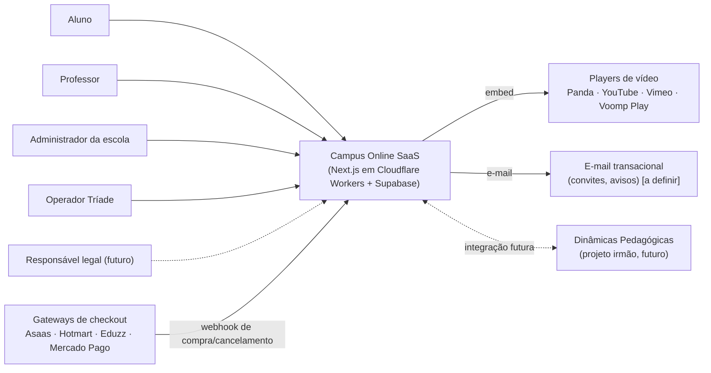

# PRD — Campus Online

**Versão:** 0.1 (rascunho para aprovação do dono) · **Data:** 2026-11-09 · **Modo:** sobre base existente (código próprio, Cenário B do método)
**Dono do produto:** Thiago Miranda (Tríade Tecnologia e Soluções)
**Insumos:** respostas do dono (09/11/2026), `docs/arquitetura/architecture.md` + ADR-001/002/003, leitura do código (`origin/main`, commit `63a4d33`), repositório irmão `dinamica-pedagogica` (somente leitura), guias do método (Gestão de Equipe, Playbook, Segurança).
**Legenda de estado:** *(herdado)* lido no código · *(herdado, a confirmar)* existe no código mas depende de DT aberto ou de teste · *(novo)* a construir · **[definir]** falta decisão ou critério.
**Nada neste PRD é "simulado".**

---

## 1. Contexto e problema

Instituições de ensino e produtores de conteúdo que querem entregar cursos online hoje escolhem entre dois mundos. As plataformas de infoprodutos (checkout, marketing, player de vídeo) são simples de vender, mas pouco pedagógicas. O Moodle e similares são completos para instituições, mas têm usabilidade pesada, exigem equipe técnica para instalar e manter, e não foram desenhados para reter e engajar o aluno.

O Campus Online nasceu como a plataforma da **Escola do Empreendedor Raiz** (produto da Tríade) e passou a ser multi-escola (multi-tenant) no commit `7d65756`. O dono quer transformá-la em um **SaaS vendido por assinatura recorrente** para escolas e infoprodutores terceiros, com a tese de ter sido **"feita de professor para professores"**: ferramentas que ajudam o professor e o aluno durante as aulas, aumentando retenção, engajamento e resultado, com gamificação de verdade (e não só ranking de participação). A plataforma deve ser capaz de **substituir o Moodle** com melhor usabilidade.

A Escola do Empreendedor Raiz é a **primeira escola real**, em uso desde já. O produto só vai ao mercado aberto quando estiver testado e "redondinho" para ela. O desenvolvimento é ágil e incremental: implementa, testa, corrige, lança a funcionalidade e parte para a próxima, com a escola já usando e vendendo.

**Estado hoje (resumo):** o núcleo de autoria (categorias, cursos, módulos, aulas, materiais), o catálogo do aluno estilo streaming, a Minha Lista e o diagnóstico de onboarding existem. Estão **no ar** na Cloudflare Workers (produção e prévia). Faltam, entre outros: bloqueio de acesso pago na tela do aluno, liberação automática por checkout, progresso do aluno, comentários, certificados, matrícula/convite, onboarding de escola e conformidade para menores.

## 2. Objetivo e métricas de sucesso

**Objetivo do produto:** ser a plataforma de cursos que o professor consegue operar sozinho e que o aluno realmente termina, para instituições e infoprodutores.

| ID | Métrica | Alvo | Como medir |
|---|---|---|---|
| M-01 | Conclusão de curso (alunos que terminam ≥ 80% das aulas) | **[definir]** (baseline: medir na Escola do Empreendedor Raiz) | Tabela de progresso (RF-17) |
| M-02 | Alunos ativos por semana / alunos matriculados | **[definir]** | Eventos de progresso e acesso |
| M-03 | Tempo entre cadastro do aluno e primeira aula assistida | **[definir]** | Progresso + data de matrícula |
| M-04 | Acesso liberado automaticamente após compra (sem ação humana) | ≥ 99% dos pedidos aprovados em até 2 minutos | Log de webhooks (RF-15) |
| M-05 | Escolas operando sem suporte da Tríade para tarefas rotineiras | **[definir]** | Chamados por escola/mês |
| M-06 | Custo direto por escola (infra) em relação à mensalidade | **[definir]**; depende do preço | Seção 10, pendência P-02 |

Os alvos só podem ser fechados depois da primeira medição real na Escola do Empreendedor Raiz.

## 3. Personas e casos de uso

> O **Avatar, a persona e o ICP comerciais ainda não foram definidos** pelo dono (pendência P-01). As personas abaixo são **de uso do produto**, não de venda.

| ID | Persona | O que precisa conseguir |
|---|---|---|
| P1 | **Professor / autor** | Montar curso, módulo e aula sem ajuda técnica; publicar com segurança; responder dúvidas; acompanhar o aluno |
| P2 | **Aluno** (hoje adulto; amanhã possivelmente menor de idade) | Entrar na escola, achar o curso, assistir, retomar de onde parou, tirar dúvidas, receber certificado |
| P3 | **Administrador da escola** (gestor de infoprodutor ou secretaria da instituição) | Gerenciar professores e alunos, liberar acesso (automático ou manual), configurar integrações de checkout, ver o estado da escola |
| P4 | **Coordenador pedagógico** (instituição) | Acompanhar o andamento das turmas e dos professores *(RF-20, prioridade menor)* |
| P5 | **Operador Tríade** (superadmin) | Criar, suspender e acompanhar escolas; garantir que o isolamento e a cobrança funcionem |
| P6 | **Responsável legal do aluno menor** | Dar consentimento e acompanhar o uso *(futuro; ver RF-27)* |

**Dois segmentos de cliente** com fluxos de acesso diferentes (DP-05):
- **Infoprodutor:** o aluno compra em um checkout escolhido pelo cliente (Asaas, Hotmart, Eduzz, Mercado Pago etc.) e o acesso precisa ser liberado **automaticamente**.
- **Instituição de ensino** (faculdade, escola tradicional): já tem meios de pagamento próprios; o curso nem sempre é vendido online; a liberação pode ser **manual ou em lote**.

## 4. Escopo

### 4.1 Dentro do escopo da v1 (portão A: Escola do Empreendedor Raiz operando "redondinho")
Os requisitos marcados **M** nas seções 5.1 a 5.6, **exceto** RF-22 (cobrança das escolas), que é Must só no portão B, e RF-27 (menores), que é Should na v1. Mais os **portões de lançamento** da seção 10 (DT-01 a DT-06 do `architecture.md`).

### 4.2 Antes de abrir ao mercado (portão B)
Cobrança da assinatura das escolas (RF-22), documentos legais (termos, contrato de operador de dados, política de privacidade), conformidade para menores (RF-27), definição de preço e ICP. Sem prazo definido.

### 4.3 Fora do escopo da v1 (versões futuras, por decisão do dono)
- **Comunidade** (fórum/feed entre alunos).
- **Gamificação** baseada no framework Octalysis e elementos de jogo.
- **Dinâmicas pedagógicas** e integração com a plataforma Dinâmicas Pedagógicas (projeto irmão).
- Hospedagem de vídeo próprio (vídeo sempre por player externo; premissa já registrada no `architecture.md` §1.3).
- **Aulas ao vivo** (ficam registradas na Voomp Play; ver DP-07).
- Emissão de certificados da extensão Anhanguera (processo separado, depende do consumo na Voomp Play).

## 5. Requisitos funcionais

**Prioridade (MoSCoW):** **M** = Must (v1), **S** = Should (v1, se couber), **C** = Could, **W** = Won't na v1 (registrado para versões futuras).
Por estarem em discussão poucos itens concorrentes e sem dados quantitativos de impacto, **não foi usado RICE**.
Cada critério é no formato **Dado/Quando/Então**, para virar teste antes do código.

### 5.1 Acesso, escolas e pessoas

**RF-01 — Entrar na escola pelo código** *(herdado, a confirmar)* · M
Como aluno ou professor, quero informar o código da escola e chegar à tela de acesso dela, para entrar no ambiente certo.
Dado um código de escola existente, quando eu o informo na home, então sou levado a `/s/<código>` com login e cadastro. Dado um código inexistente, então vejo mensagem de código inválido. *Obs.: o código tem atalho de demonstração fixo (`demo`, `escola-raiz`) a remover (ver 10, R-09).*

**RF-02 — Login e sessão** *(herdado, a confirmar)* · M
Como usuário, quero entrar com e-mail e senha e manter a sessão, para não me autenticar a cada visita.
Dado um usuário membro da escola, quando entra com credenciais válidas, então vê a área do seu papel. Dado um usuário que não é membro da escola, então não vê nenhum dado dela.

**RF-03 — Papéis por escola** *(herdado, a confirmar)* · M
Como administrador, quero que cada pessoa tenha um papel na escola (ADMIN, TEACHER, STUDENT), para controlar o que cada uma faz.
Dado um aluno, quando tenta abrir `/teacher/*` ou gravar em tabela de conteúdo, então é barrado (na interface e no banco).

**RF-24 — Gestão de membros pela administração** *(novo)* · M
Como administrador da escola, quero listar, convidar, trocar o papel e remover professores e alunos, para manter a escola organizada.
Dado um administrador, quando remove um aluno, então ele perde o acesso à escola imediatamente e o histórico é preservado para efeito de auditoria.

**RF-14 — Convite de alunos e professores** *(novo)* · M
Como administrador, quero gerar um link ou enviar e-mail de convite, para que a pessoa entre já vinculada à escola e ao papel certo.
Dado um convite válido, quando a pessoa o abre e conclui o cadastro, então passa a ser membro com o papel do convite. Dado um convite expirado ou já usado, então o cadastro é recusado com mensagem clara.

**RF-21 — Auto-cadastro de escola (onboarding)** *(novo)* · M
Como futuro cliente, quero criar a minha escola sozinho, para começar sem depender da Tríade.
Dado um visitante que informa nome da escola e dados do administrador, quando conclui, então a escola é criada com um código único, o administrador vira ADMIN e a escola nasce com as tabelas isoladas por `school_id`. *Hoje a criação é manual por SQL (README §7).*

**RF-23 — Painel do operador Tríade** *(novo)* · M
Como operador, quero criar, suspender e consultar escolas e seu uso, para operar o SaaS.
Dado um operador autenticado, quando suspende uma escola, então ninguém dela consegue entrar; os dados permanecem intactos. Usuário que não é operador não vê o painel.

**RF-25 — Marca da escola** *(novo, a confirmar com o dono)* · S
Como administrador, quero colocar nome, logo e cor da minha escola, para o aluno reconhecer o ambiente como da minha instituição.

### 5.2 Autoria de conteúdo (professor)

**RF-04 — Categorias** *(herdado, a confirmar)* · M
Dado um professor, quando cria, edita, reordena ou exclui uma categoria da sua escola, então a lista é atualizada e não aparece em outra escola.

**RF-05 — Cursos com capas e publicação validada** *(herdado, a confirmar)* · M
Dado um curso em rascunho com pelo menos 1 módulo e 1 aula publicada, quando o professor clica em publicar, então o curso aparece no catálogo do aluno. Dado um curso sem esses requisitos, então a publicação é recusada com a lista do que falta.

**RF-06 — Módulos e aulas com reordenação** *(herdado, a confirmar)* · M
Dado um curso, quando o professor arrasta módulos ou aulas, então a nova ordem é salva e vista pelo aluno.

**RF-07 — Aula com vídeo externo e materiais** *(herdado, a confirmar)* · M
Dado uma aula com embed de player externo (Panda, YouTube, Vimeo) e materiais (link ou PDF), quando o aluno a abre, então vê o vídeo e baixa os materiais. *Requisito de segurança: ver RNF-12.*

**RF-28 — Aula com link externo (Voomp Play)** *(novo)* · C
Como professor, quero registrar uma aula cujo conteúdo está na Voomp Play (gravação de aula ao vivo), para o aluno achá-la no mesmo curso. Dado um link permitido, quando o aluno abre a aula, então vê o conteúdo ou é levado a ele.

### 5.3 Área do aluno

**RF-08 — Catálogo estilo streaming, Minha Lista e perfil** *(herdado, a confirmar)* · M
Dado um aluno logado, quando abre a home, então vê os cursos publicados da sua escola por categoria, pode adicionar à Minha Lista e editar foto e bio.

**RF-09 — Diagnóstico de onboarding e trilha** *(herdado, a confirmar)* · M
Dado um aluno novo, quando responde o quiz, então recebe as categorias recomendadas, que ficam salvas; ao voltar, vê o resultado sem refazer.

**RF-17 — Progresso e "continuar de onde parou"** *(novo)* · M
Como aluno, quero marcar aulas como concluídas e voltar à última aula aberta, para retomar sem procurar.
Dado um aluno que conclui uma aula, quando abre o curso, então vê o percentual concluído e um botão "continuar" que leva à próxima aula não concluída. O progresso é por aluno e por escola.

**RF-18 — Dúvidas e comentários por aula** *(novo)* · M
Como aluno, quero fazer perguntas na aula e receber resposta do professor, para não travar.
Dado um aluno, quando publica uma pergunta, então o professor da escola a vê e pode responder; alunos de outra escola nunca a veem. O professor pode ocultar comentários inadequados.

**RF-19 — Certificado de conclusão** *(novo)* · M
Como aluno, quero receber um certificado ao concluir o curso, para comprovar o estudo.
Dado um aluno que cumpre a regra de conclusão do curso, quando solicita o certificado, então recebe um PDF com nome, curso, carga horária, data e **código de verificação**. Dado o código, quando alguém o consulta publicamente, então vê se é válido (sem expor dados além do necessário). Os certificados **não têm relação** com a extensão Anhanguera (DP-07).

### 5.4 Acesso comercial (direito de acessar cada curso)

**RF-10 — Modelo de acesso do curso** *(herdado, a confirmar)* · M
Dado um curso, o administrador define se é **aberto**, por **assinatura** (chave `COMMUNITY_ANNUAL` hoje fixa) ou por **compra avulsa** (chave `COURSE:<id>`); o professor comum não altera esse campo (trigger no banco). *Nota: as chaves e os Tiers refletem o modelo comercial da Escola do Empreendedor Raiz e estão fixos no código; ver CA-05 e P-04.*

**RF-11 — Bloqueio de acesso na área do aluno** *(novo, portão: DT-05)* · M
Dado um curso que exige direito de acesso, quando um aluno **sem** direito ativo tenta abrir o curso ou a aula (inclusive por URL direta), então vê a tela de "acesso necessário" e **nenhum conteúdo** é entregue. Dado um aluno com direito ativo, então abre normalmente. O bloqueio vale no servidor/banco, não só na interface.

**RF-12 — Liberação manual de acesso** *(novo)* · M
Como administrador, quero liberar ou revogar o acesso de um aluno a um curso ou plano, com data de início e fim opcionais, para atender instituições e casos especiais.
Dado um administrador, quando libera, então o aluno passa a ter acesso; quando revoga, então perde. A origem fica registrada como `MANUAL`.

**RF-13 — Matrícula em lote (CSV)** *(novo)* · M
Como administrador de instituição, quero importar uma planilha de alunos e cursos, para matricular uma turma inteira de uma vez.
Dado um CSV válido, quando importo, então cada linha cria ou vincula o aluno e libera o acesso; linhas inválidas são listadas com o motivo e **nenhuma** linha é perdida em silêncio.

**RF-15 — Liberação automática por checkout (webhook)** *(novo)* · M
Como administrador de infoprodutor, quero ligar o checkout que uso (Asaas, Hotmart, Eduzz, Mercado Pago etc.) e ter o acesso liberado automaticamente após a compra aprovada.
Dado um pedido aprovado vindo do gateway configurado da escola, quando o webhook chega com assinatura válida, então o aluno ganha o direito de acesso correspondente (criando a conta e enviando o convite, se necessário). O mesmo pedido recebido duas vezes **não** duplica o acesso (idempotência por `provider + order_id`). Webhook sem assinatura válida é recusado e registrado. *Nota: o schema atual cobre `ASAAS`, `HOTMART`, `EDUZZ`, `MONETIZZE`, `VOOMP`, `STRIPE`; **Mercado Pago não existe** e precisa ser incluído (CA-04).*

**RF-16 — Revogação automática** *(novo)* · M
Dado um cancelamento, reembolso, chargeback ou fim de vigência, quando o evento chega (ou a data passa), então o direito de acesso vira `CANCELED` ou `EXPIRED` e o aluno perde o acesso, mantendo o histórico de progresso.

### 5.5 Gestão e dados

**RF-20 — Analytics do professor e do coordenador** *(novo)* · S (prioridade menor, por decisão do dono)
Dado um professor, quando abre o painel, então vê alunos ativos, conclusão por curso e aulas com maior abandono, apenas da sua escola.

**RF-22 — Assinatura da escola (cobrança do SaaS)** *(novo)* · M **no portão B** (antes do mercado aberto), fora do portão A
Como Tríade, quero cobrar cada escola por assinatura mensal ou anual e suspender por inadimplência, para ter receita recorrente. Preço e planos dependem de P-01 e P-02.

### 5.6 Privacidade e menores

**RF-26 — Direitos do titular (LGPD)** *(novo)* · M
Dado um aluno ou a escola (controladora), quando solicitam exportar ou excluir os dados do aluno, então a plataforma entrega o arquivo e/ou apaga os dados pessoais dentro do prazo definido pela escola, sem afetar outros alunos. **[definir]** prazo e política de retenção.

**RF-27 — Preparação para menores de idade** *(novo)* · S na v1, **M antes de vender para escolas de ensino fundamental e médio**
Como escola cliente, quero cadastrar alunos menores com vínculo a um responsável e registro de consentimento, para usar a plataforma com conformidade. Dado um aluno menor, quando a escola o cadastra, então o sistema registra a faixa etária e o responsável e aplica as restrições da escola (por exemplo, comentários moderados ou desligados). **[definir]** regras exatas com o advogado (ver RNF-06).

### 5.7 Versões futuras (registradas, não entram na v1) · W

| ID | Capacidade | Observação |
|---|---|---|
| RF-F01 | **Comunidade** entre alunos | Fórum/feed por escola e por curso; depende de moderação (RF-18) |
| RF-F02 | **Gamificação** baseada em Octalysis e elementos de jogo | Ver Apêndice A. Restrição legal: sem "caixas de recompensa" para menores (RNF-06) |
| RF-F03 | **Dinâmicas pedagógicas** e integração com o projeto Dinâmicas Pedagógicas | Projeto irmão em desenvolvimento; ver CA-06 |

## 6. Requisitos não funcionais

| ID | Requisito | Critério verificável | Pendência |
|---|---|---|---|
| RNF-01 | Isolamento entre escolas | Usuário membro da escola A recebe **0 registros** de qualquer tabela de conteúdo, matrícula, progresso, comentário ou certificado da escola B (teste automatizado com duas escolas). Toda tabela nova nasce com `school_id` e RLS (ARQ-01) | Nenhuma |
| RNF-02 | Build limpo antes de qualquer deploy | `npx tsc --noEmit` e `npx opennextjs-cloudflare build` saem com código 0 | Confirmar DT-01 corrigido |
| RNF-03 | Desempenho na borda | TTFB da casca de `/` e do login ≤ **800 ms (p95)** (RQ-03) | Premissa; revisar com 100 alunos reais |
| RNF-04 | Disponibilidade e anti-pausa | Banco ativo (heartbeat a cada 72 h enquanto no plano gratuito, RQ-01). Meta de disponibilidade após plano pago **[definir]** | Meta de SLA |
| RNF-05 | LGPD | Escola é **controladora** e a Tríade **operadora**; exceção: alunos da Escola do Empreendedor Raiz (Tríade controladora). Contrato de operador, política de privacidade e canal do titular existem antes do portão B | Advogado |
| RNF-06 | Proteção de crianças e adolescentes | Plataforma preparada para menores (RF-27). A Lei 15.211/2025 (ECA Digital) está em vigor desde 17/03/2026 e se soma à LGPD; entre outros pontos, veda "caixas de recompensa" em jogos para esse público e pede verificação de idade mais robusta que a autodeclaração. *Fonte secundária (imprensa e escritórios); **conferir o texto oficial com advogado*** | Advogado; regulamentação da ANPD |
| RNF-07 | Segurança de aplicação | Nível OWASP ASVS **[definir]**; proposta: **L2** (dados pessoais) e **L3 recomendado** para os módulos de webhook/pagamento e de menores. Decisão pela skill de cibersegurança no `plan.md` | Skill de segurança |
| RNF-08 | Webhooks seguros e idempotentes | Assinatura/segredo validado em 100% das chamadas; mesmo pedido repetido 10× gera 1 direito de acesso; falha de processamento é registrada e reprocessável | Detalhar por gateway |
| RNF-09 | Acessibilidade | Telas do aluno e do professor atendem **WCAG 2.1 AA** **[definir]** (instituições costumam exigir) | Confirmar com UI/UX |
| RNF-10 | Backup e recuperação | Backup diário restaurável do banco e dos arquivos **[definir]** (o plano gratuito do Supabase não inclui backup; ver EV-03) | Meta de RPO/RTO |
| RNF-11 | Custo direto por escola | Custo mensal de infraestrutura por escola abaixo de **[definir]%** da mensalidade, em pior caso | P-02 |
| RNF-12 | Embed de vídeo seguro | Nenhum script arbitrário executa a partir do campo de embed da aula; só `iframe` de domínios permitidos. Hoje o HTML é renderizado com `dangerouslySetInnerHTML` (4 pontos no código) | Corrigir antes do portão B |
| RNF-13 | Uso em celular | Fluxos do aluno (assistir, progresso, comentar) completos em tela de 360 px de largura **[definir]** prioridade por persona | UI/UX |
| RNF-14 | Rastreabilidade de acesso | Toda liberação ou revogação de acesso registra origem, data e autor | Nenhuma |

## 7. Direção arquitetural (herdada)

O PRD **não reabre** a arquitetura. O estilo, a stack e o isolamento já foram decididos e auditados em `docs/arquitetura/architecture.md` (ADR-001, ADR-002, ADR-003): **monolito Next.js 15 (App Router) sobre Supabase (Auth, Postgres com RLS, Storage), hospedado em Cloudflare Workers via OpenNext, multi-tenant por `school_id` em banco compartilhado**. Neste PRD isso entra como restrição, com os custos de troca ali descritos. As decisões novas que os requisitos geram estão na seção 12 como candidatas a ADR (`CA-NN`).

*Legenda: o sistema (centro), quem o usa (esquerda) e os sistemas externos com que conversa (direita). Linhas tracejadas são futuras ou opcionais.*

**Checagem rápida dos 6 pilares (resumo):** *Segurança* é o ponto mais pesado (isolamento por RLS, webhooks, menores) → RNF-01, 07, 08, 12. *Confiabilidade* depende de backup e SLA ainda indefinidos → RNF-04, 10. *Custo* está sob controle no gratuito, com gatilhos EV-02/EV-03 do `architecture.md` → RNF-11. *Excelência operacional, desempenho e sustentabilidade* não são preocupação nova nesta fase.

## 8. Stack tecnológica (herdada)

| Camada | Tecnologia | Fonte |
|---|---|---|
| Aplicação | Next.js 15.5, React 19, TypeScript, Tailwind CSS 3 | `package.json`, ADR-001 |
| Banco, login e arquivos | Supabase (Postgres + RLS, Auth, Storage) via `@supabase/ssr` | ADR-001 |
| Hospedagem e deploy | Cloudflare Workers + `@opennextjs/cloudflare`; GitHub → Workers Builds; prévia por branch `develop` | ADR-003 e operação de 08/11/2026 |
| Reordenação de currículo | `@dnd-kit` | `package.json` |
| Vídeo | Embed de player externo | `architecture.md` §5 |

## 9. Modelo de dados (visão geral)

**Existentes** *(herdado)*: `schools` · `users_profile` · `school_members` (papel por escola) · `category` · `course` (com `access_model`, `course_tier`, `required_entitlement_key`) · `module` · `lesson` · `resource` · `entitlements` (direito de acesso, com `provider`, `provider_order_id`, `status`, `starts_at/ends_at`) · `course_watchlist` · `diagnostic_questions` / `diagnostic_options` / `user_diagnostic_results` · view `course_stats`.

**Novas necessárias (candidatas; schema detalhado é da SDD):**

| Entidade | Para quê | Requisito |
|---|---|---|
| `lesson_progress` (aluno, aula, concluída, última posição) | Progresso e "continuar" | RF-17 |
| `lesson_comment` (aula, autor, texto, resposta a, oculto) | Dúvidas e comentários | RF-18 |
| `certificate` (aluno, curso, código de verificação, emitido em) | Certificado verificável | RF-19 |
| `invitation` (escola, papel, token, validade, usado) | Convite | RF-14 |
| `enrollment_import` (lote, linha, resultado) | Matrícula em lote com relatório de erros | RF-13 |
| `gateway_integration` (escola, provedor, segredo, mapeamento produto → chave de acesso) | Webhooks por escola | RF-15 |
| `webhook_event` (provedor, id do evento, payload, resultado) | Idempotência e auditoria | RF-15, 16, RNF-08 |
| `school_subscription` (escola, plano, ciclo, status) | Cobrança do SaaS | RF-22 |
| `guardian_link` e `consent_record` (aluno menor, responsável, consentimento) | Menores | RF-27 |
| `data_request` (titular, tipo, status) | Direitos LGPD | RF-26 |
| `access_audit` ou uso de `entitlements.metadata` | Rastreio de liberação/revogação | RNF-14 |

Conferência de identidade e relacionamentos: cada entidade acima pertence a uma escola (`school_id`) e, quando aplicável, a um aluno (`user_id`) e a um curso/aula. `entitlements` é a **única** fonte da verdade do direito de acesso; os gateways apenas **criam e encerram** linhas nela.

## 10. Riscos, premissas e portões de lançamento

### 10.1 Portões do portão A (precisam estar resolvidos antes de declarar "pronto" para a Escola do Empreendedor Raiz)

| ID | Item | Origem | Estado |
|---|---|---|---|
| G-01 | Banco recriado do zero com `supabase/bootstrap_completo.sql` e testado (cadastro de professor, categoria, curso) | DT-02, DT-03 | **aberto** (conferir se já foi rodado no projeto Supabase novo) |
| G-02 | `tsc --noEmit` e `opennextjs-cloudflare build` com código 0 | DT-01 | build de produção passou em 08/11; **conferir `tsc` isolado** |
| G-03 | RLS em `entitlements` e bloqueio por direito de acesso no servidor | DT-05, RF-11 | **aberto** |
| G-04 | Remoção das rotas legadas `app/student/*`, `app/teacher/modules/[id]` e de `lib/supabase.ts` | DT-06 | **aberto** |
| G-05 | `slug` único **por escola** (não global) | DT-04 | Conferir no bootstrap |
| G-06 | Embed de vídeo sanitizado | RNF-12 | **aberto** |
| G-07 | Proteção da branch `main` (Pull Request obrigatório) | Operação | **aberto** |

### 10.2 Riscos e premissas

| ID | Risco ou premissa | Estado / gatilho |
|---|---|---|
| R-01 | **Preview e produção usam o mesmo banco** (decisão do dono, 08/11/2026). Teste na prévia grava dado real; faixa de aviso na prévia mitiga | Aberto; trocar por banco separado antes de existir dado de terceiros |
| R-02 | Tiers e chaves de acesso fixos no código refletem só o modelo da Escola do Empreendedor Raiz | Aberto; CA-05 |
| R-03 | Limites do plano gratuito (Supabase 500 MB / pausa em 7 dias; Workers 100 mil requisições/dia) | Mitigado em parte (heartbeat); gatilhos EV-02/EV-03 |
| R-04 | Segredos dos gateways (por escola) guardados no banco: exposição compromete vendas de terceiros | Aberto; decisão de cofre/criptografia em CA-04 + segurança |
| R-05 | Marketing de gamificação sem evidência própria: a literatura mostra efeito positivo **condicionado à qualidade do desenho**; a evidência específica do Octalysis em plataformas de curso é fraca (Apêndice A) | Aberto; validar com a Escola do Empreendedor Raiz |
| R-06 | Conformidade para menores e ECA Digital em evolução (regulamentação pela ANPD) | **Depende de terceiro** (advogado) |
| R-07 | Dependência de gateways e de seus webhooks (formatos mudam; Mercado Pago ausente no schema) | Aberto |
| R-08 | Dois projetos irmãos (Campus Online em Next.js/Supabase; Dinâmicas Pedagógicas em TanStack Start/Lovable Cloud) com bancos e logins separados | Aberto; CA-06 |
| R-09 | Atalho `demo` / `escola-raiz` fixo na home do código e mensagens de dados reais na documentação (`README.md` e `DOCUMENTACAO.md` desatualizados) | Aberto; limpar na tarefa de base da SDD |
| P-premissa | Volume inicial: até 5 escolas e 500 alunos simultâneos (premissa do `architecture.md`) | Revisar após a primeira medição real |

## 11. Roadmap de fases

| Fase | Entrega | Critério para fechar |
|---|---|---|
| **0 — Base** | Portões G-01 a G-07; medição do que já funciona na Escola do Empreendedor Raiz (tarefa de base da SDD) | Instala, compila, testes de isolamento passando |
| **1 — Acesso confiável** | RF-11, RF-12, RF-13, RF-14, RF-24 | Nenhum aluno vê curso pago sem direito; admin matricula sem SQL |
| **2 — Liberação automática** | RF-15, RF-16 (um gateway por vez, começando pelo da Escola do Empreendedor Raiz) | M-04 atingida em produção |
| **3 — Experiência do aluno** | RF-17, RF-18, RF-19 | Progresso, dúvidas e certificado usados por alunos reais |
| **4 — Operação como SaaS** | RF-21, RF-23, RF-25, RF-26, RF-27 (base) | Escola nova criada sem a Tríade tocar no banco |
| **5 — Mercado** (portão B) | RF-22, termos e contratos, conformidade para menores, preço e ICP | Aprovação do dono e do advogado |
| **Depois** | RF-20 (analytics); RF-F01 (comunidade); RF-F02 (gamificação Octalysis); RF-F03 (dinâmicas pedagógicas) | Priorização por dado de uso |

Cada fase segue o ciclo ágil pedido pelo dono: **implementar, testar, corrigir, testar, lançar a funcionalidade** e partir para a próxima, com a Escola do Empreendedor Raiz já usando. Cada funcionalidade passa pelo pipeline do método (UI/UX → arquitetura → SDD + segurança + QA), só com o que muda.

## 12. Decisões

### 12.1 Decisões de produto (DP-NN)

| ID | Decisão | Por quê | Quem decidiu | Pendência |
|---|---|---|---|---|
| DP-01 | Vender para **escolas e infoprodutores terceiros**; a **Escola do Empreendedor Raiz é a primeira escola real e de teste** | Validar com uso real antes de abrir ao mercado | Dono, 09/11/2026 | — |
| DP-02 | Dois portões: **A** = operando "redondinho" na Escola do Empreendedor Raiz; **B** = pronto para o mercado aberto | O dono só abre ao mercado depois de testado | Dono | Sem data para B |
| DP-03 | Posicionamento: "feita de professor para professores", **substituto de Moodle com usabilidade superior**; diferencial em retenção, engajamento e resultado | As concorrentes focam em checkout, marketing e player | Dono | Validar (Apêndice A) |
| DP-04 | **Assinatura recorrente mensal ou anual**; a Tríade arca com a infraestrutura e entrega "tudo pronto" | Modelo de SaaS | Dono | **Preço indefinido** (depende de Avatar, persona e ICP: P-01, P-02) |
| DP-05 | Dois fluxos de acesso: **automático** (infoprodutor, via checkout) e **manual/lote** (instituição) | Perfis de cliente diferentes | Dono | — |
| DP-06 | **Escola cliente = controladora** dos dados; **Tríade = operadora**. Exceção: alunos da Escola do Empreendedor Raiz (Tríade controladora) | Estrutura jurídica do SaaS | Dono | Redação contratual com advogado |
| DP-07 | Certificados do Campus Online **não** têm relação com a extensão Anhanguera; aulas ao vivo ficam na Voomp Play; o Campus Online entrega os cursos e materiais bônus | Regras do parceiro (consumo na Voomp Play) | Dono | — |
| DP-08 | Desenvolvimento **ágil e incremental**, em uso desde já, sem meta de lançamento ao mercado | Preferência do dono | Dono | — |
| DP-09 | **Analytics** com prioridade menor; **Comunidade, Gamificação Octalysis e Dinâmicas Pedagógicas** ficam para versões futuras | Escopo da v1 | Dono | — |
| DP-10 | Plataforma será **preparada para menores de idade** | Possível venda para ensino fundamental e médio | Dono | Regras exatas com advogado (RF-27) |

### 12.2 Decisões técnicas candidatas a ADR (CA-NN), para a arquitetura formalizar

| ID | Candidata | Contexto |
|---|---|---|
| CA-01 | Autorização de acesso a conteúdo **no servidor/banco** (RLS + checagem de `entitlements`) e não só na interface | RF-11; hoje a UI do aluno não confere o direito |
| CA-02 | **Tipos de papel globais vs. por escola** e criação do papel de **operador Tríade** (superadmin) fora de `school_members` | RF-23; `users_profile.role` e `school_members.role` coexistem hoje |
| CA-03 | Onde roda a **lógica de servidor** que o BaaS puro não resolve (webhooks, convites, certificados em PDF, importação CSV): Route Handlers do Next.js nos Workers vs. Supabase Edge Functions | Revisitar a regra "sem backend próprio" (EV-04) |
| CA-04 | Arquitetura de **integração com gateways**: um adaptador por provedor, segredos por escola (criptografia/cofre), idempotência e reprocesso; incluir Mercado Pago no schema | RF-15, RF-16, RNF-08, R-04, R-07 |
| CA-05 | Generalizar **Tiers e chaves de acesso** (`COMMUNITY_ANNUAL`, `COURSE:<id>`) para **planos configuráveis por escola** | O Tier é só "classificação estratégica" e as chaves refletem o modelo da Escola do Empreendedor Raiz (código `course-form.tsx`) |
| CA-06 | Integração com **Dinâmicas Pedagógicas**: link assinado/SSO, incorporação em aula, devolução de resultado; bancos hoje separados | RF-F03, R-08 |
| CA-07 | Estratégia de **ambientes** (banco de prévia separado do de produção, migrações versionadas, chaves por ambiente) | R-01 |
| CA-08 | **Geração e verificação de certificado** (PDF, código público) e **sanitização do embed** | RF-19, RNF-12 |
| CA-09 | **Cobrança da assinatura das escolas** (provedor, ciclo, suspensão automática) | RF-22 |

*Decisões mistas:* DP-05 gera CA-04; DP-06/DP-10 geram requisitos de segurança e privacidade (RNF-05, 06, 07) a serem tratados pela skill de cibersegurança; DP-09 mantém RF-F01 a RF-F03 fora do desenho atual.

### 12.3 Pendências para o dono (nada abaixo foi decidido neste PRD)

| ID | Pendência | Quem responde |
|---|---|---|
| P-01 | Avatar, persona e ICP comerciais | Dono (com a skill `vtsd-metodo`) |
| P-02 | Preço, planos, o que a mensalidade inclui, conta de custo direto por escola | Dono |
| P-03 | Metas de M-01, M-02, M-03 e M-05 (após primeira medição) | Dono |
| P-04 | Confirmar o significado de Tiers e `COMMUNITY_ANNUAL` com base no código: **Tier é só classificação; acesso real é por Assinatura (`COMMUNITY_ANNUAL`), Compra avulsa (`COURSE:<id>`) ou Aberto. Tiers 1 e 2 sugerem "comunidade/base"; 3 a 5 sugerem "venda avulsa" (Certificação, Formação, Pós-graduação)** | Dono |
| P-05 | Marca branca (RF-25): a escola personaliza nome, logo e cor? | Dono |
| P-06 | Termos, contrato de operador de dados, política de privacidade, ECA Digital | **Advogado** |
| P-07 | Meta de disponibilidade, backup e recuperação (RNF-04, 10) | Dono |
| P-08 | E-mail transacional: qual provedor? | Dono / arquitetura |
| P-09 | Se o banco da prévia continuará compartilhado com produção (R-01) | Dono |

## 13. Capacidades herdadas, novas e não verificadas

| Capacidade | Estado | Evidência |
|---|---|---|
| Multi-escola por `school_id` + RLS | Herdada, a confirmar | `supabase/bootstrap_completo.sql` §1 e §4; ADR-002 |
| Cadastro de professor por escola | Herdada, a confirmar | `app/s/[schoolSlug]/signup-professor/page.tsx`; trigger `on_auth_user_created` (bootstrap L.54-77) |
| Categorias, cursos, módulos, aulas, materiais | Herdada, a confirmar | `app/teacher/*`; tabelas no bootstrap |
| Editor de currículo com arrastar-e-soltar | Herdada, a confirmar | `app/teacher/courses/[id]/curriculum-builder.tsx` |
| Validação de publicação (≥1 módulo e ≥1 aula publicada) | Herdada, a confirmar | `lib/course-publishing.ts` |
| Home estilo streaming, Minha Lista, perfil | Herdada, a confirmar | `app/s/[schoolSlug]/student/*` |
| Diagnóstico de onboarding | Herdada, a confirmar | `student/discovery/page.tsx`; tabelas `diagnostic_*` |
| Modelo de acesso no cadastro do curso (Aberto/Assinatura/Avulso) e Tiers | Herdada, **só no cadastro** | `app/teacher/courses/course-form.tsx`; trigger `tr_enforce_course_admin_only_fields` |
| Bloqueio de acesso pago para o aluno | **Não existe** | `architecture.md` DT-05; nenhuma checagem de `entitlements` em `app/s/[schoolSlug]/student/*` |
| Liberação por checkout (webhook) | **Só schema** (`entitlements.provider`) | Sem rota de webhook em `app/` |
| Progresso, comentários, certificados, analytics | **Não existem** | Sem tabela correspondente no bootstrap |
| Matrícula/convite, auto-cadastro de escola, painel de operador | **Não existem** (escola criada por SQL) | `README.md` §7 |
| Preparação para menores | **Não existe** | — |

---

## Apêndice A — Diferenciais candidatos e validação (hipóteses; **não** são requisitos)

> Este apêndice responde ao pedido do dono de **pesquisar e validar funcionalidades de alto valor** para diferenciar a plataforma. **Nível de evidência:** uma rodada de pesquisa na web (09/11/2026) deu **resultado fraco** para o mercado de LMS no Brasil e para a eficácia específica do Octalysis. O que está aqui é, em grande parte, **conhecimento geral do assistente**, marcado como hipótese. A validação de verdade vem de **entrevistas com a Escola do Empreendedor Raiz e 5 a 8 instituições** (a ser feita). **Próximo passo recomendado:** pesquisa de mercado aprofundada e definição de ICP.

### A.1 O que a pesquisa confirmou

- **Gamificação melhora engajamento e, às vezes, retenção, mas só quando o desenho leva a aprendizado de fato** (revisão sistemática sobre LMS de treinamento regulatório; fornecedores de LMS repetem que pontos e emblemas sozinhos não bastam). Isso **apoia a tese do dono** ("gamificação de verdade, não só ranking"). Fontes: [Learning Guild](https://www.learningguild.com/?p=9044), [Opigno](https://opigno.org/blog/strategic-gamification-how-drive-lms-engagement).
- **Evidência independente específica do Octalysis em plataformas de curso é fraca.** O que existe vem do próprio Octalysis Group (alegações sem método publicado) e de um estudo com aula presencial de idiomas. **Tratar como hipótese a validar na Escola do Empreendedor Raiz**, medindo M-01 e M-02. Fonte: [Octalysis Group](https://octalysisgroup.com/?p=12497).
- **Interoperabilidade**: SCORM (pacote de conteúdo), xAPI (dados de atividade) e LTI (ferramenta externa e login único) resolvem problemas diferentes; LTI não substitui SCORM nem xAPI. Quem compara com Moodle precisa decidir quais cobrir. Fonte: [eLearning Industry](https://elearningindustry.com/scorm-xapi-and-lti-what-every-lms-buyer-needs-to-know).
- **ECA Digital (Lei 15.211/2025)** está em vigor desde 17/03/2026 e se soma à LGPD; vedação de loot boxes para esse público e verificação de idade mais robusta (fontes secundárias; conferir o texto oficial). Fontes: [Conjur](https://www.conjur.com.br/2026-mar-21/eca-digital-a-resposta-a-nova-infancia-consumidora//?print=1), [Machado Meyer](https://www.machadomeyer.com.br/images/ebooks/Factsheet_ECA_Digital.pdf), [Computer Weekly Brasil](https://www.computerweekly.com/br/reportagen/ECA-Digital-obrigacoes-penalidades-e-o-que-muda-para-plataformas-digitais-no-Brasil).

### A.2 Candidatas a diferencial (hipóteses do assistente, confiança média, a validar em entrevistas)

| # | Candidata | Valor para o negócio (hipótese) | Esforço | Observação |
|---|---|---|---|---|
| D1 | **Gamificação Octalysis "de verdade"** (progressão, narrativa, desafios, metas de domínio, e não só ranking) | Bandeira do posicionamento; retenção e conclusão | Alto | **Evitar** recompensas aleatórias pagas para menores; medir antes e depois |
| D2 | **Dinâmicas pedagógicas dentro da aula** (quiz, nuvem de palavras, correção automática com IA, provas) via projeto irmão | Ferramenta de professor que concorrentes de infoproduto não têm; liga ao posicionamento "de professor para professores" | Médio (já existe em outro projeto) | Ver CA-06; o projeto irmão já tem provas, dissertativas com IA, nuvem de palavras e experiência gamificada para o aluno |
| D3 | **Importação e exportação padrão (SCORM, LTI 1.3, xAPI)** | Pré-requisito comum de instituições que hoje usam Moodle | Alto | Verificar quais padrões os clientes-alvo exigem |
| D4 | **Migração assistida do Moodle** (importar cursos, alunos, notas) | Reduz o atrito de troca; reforça "substituir o Moodle" | Alto | Entrevistar quem usa Moodle |
| D5 | **Boletim, notas, frequência e turmas** | Rotina básica de escola tradicional que infoprodutor não precisa | Médio | Define o ICP: se for K-12/faculdade, entra cedo |
| D6 | **Portal do responsável** (progresso e comunicados do aluno menor) | Diferencial para ensino fundamental e médio | Médio | Liga a RF-27 |
| D7 | **Alertas de risco de evasão** (aluno parado, queda de ritmo) com aviso ao professor | Ataca diretamente a retenção, a promessa central | Médio | Depende de RF-17 e RF-20 |
| D8 | **Login com Google/Microsoft (SSO institucional)** | Esperado por escolas e faculdades | Baixo/Médio | Avaliar junto à segurança |
| D9 | **Assistente de IA para o professor** (criar quiz e resumo a partir do conteúdo da aula) | Economiza tempo do professor; diferencial de "ferramenta de professor" | Médio | Reaproveita o que o projeto irmão já faz |
| D10 | **Acessibilidade WCAG AA e legenda/transcrição de vídeo** | Exigência frequente de instituições | Médio | Liga a RNF-09 |

### A.3 Como transformar hipótese em decisão

1. Definir o **ICP** (infoprodutor ou instituição? qual nível de ensino?) com a skill de método comercial; o ICP muda quais itens entram primeiro (D3 a D6 pesam muito mais para instituição).
2. Fazer **entrevistas de descoberta** (Escola do Empreendedor Raiz e 5 a 8 prospects) com perguntas sobre dor atual com Moodle ou plataforma atual.
3. Medir **baseline** (M-01 a M-03) na Escola do Empreendedor Raiz antes de qualquer gamificação, para provar o efeito depois.
4. Reclassificar D1 a D10 com **RICE** quando houver dados.

## Apêndice B — Observações sobre o projeto irmão (Dinâmicas Pedagógicas)

Repositório `ThiagoMiranda40/dinamica-pedagogica` (somente leitura): plataforma web para professores criarem **provas, dinâmicas ao vivo e atividades interativas**, com correção automática (incluindo dissertativas por IA), painéis de desempenho, **nuvem de palavras** e experiência gamificada para o aluno. Stack: TanStack Start (React 19) + Vite, Lovable Cloud (Supabase gerenciado), Cloudflare Workers, bun. **Banco e login próprios, independentes do Campus Online.** A integração entre os dois (CA-06) exige decidir como identidade, escola e resultados são trocados. Está fora da v1.

---
*Histórico de revisões: 2026-11-09, v0.1 — rascunho criado a partir das respostas do dono, do `architecture.md` e da leitura do código.*
